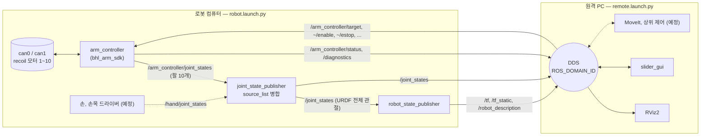

# bhl_bringup

Berkeley Humanoid Lite 상반신의 **bring-up** 패키지입니다. 로봇에 실린 컴퓨터가 로봇의 현재 상태(`/joint_states`, `/tf`, `/robot_description`, `/diagnostics`)를 내보내고, 다른 컴퓨터와 노드(RViz, 슬라이더, 앞으로의 MoveIt이나 상위 제어)는 전부 그 상태를 보고 말합니다. CAN이 어떻게 생겼는지는 로봇 쪽 `arm_controller`만 압니다.

- `robot.launch.py` — 로봇 컴퓨터(젯슨, RDK X5, 벤치 PC): `arm_controller` + `joint_state_publisher` + `robot_state_publisher`. 화면 없음
- `remote.launch.py` — 원격 PC: RViz2 + 슬라이더 패널. 하드웨어 없음
- `demo.launch.py` — 둘을 한 PC에서 (기본 연습 모드)



## 빠른 시작

```bash
cd ~/humanoid_sdk/ros2_ws
colcon build --symlink-install --packages-select bhl_arm_sdk bhl_bringup
source ../env.sh                     # ROS 2 + description 워크스페이스 + 이 워크스페이스 + ROS_DOMAIN_ID

ros2 launch bhl_bringup demo.launch.py                 # 한 PC: 연습 모드 + RViz + 슬라이더
ros2 launch bhl_bringup demo.launch.py dry_run:=false  # 벤치: 이 PC가 CAN으로 팔에 연결된 경우
```

로봇 컴퓨터와 원격 PC로 나눌 때 (둘 다 `env.sh`를 source해서 `ROS_DOMAIN_ID`를 맞춥니다):

```bash
# 로봇 컴퓨터
ros2 launch bhl_bringup robot.launch.py dry_run:=false      # CAN이 up 상태여야 함 (아래 "로봇 컴퓨터 설정")

# 원격 PC
ros2 launch bhl_bringup remote.launch.py
ros2 service call /arm_controller/enable std_srvs/srv/SetBool "{data: true}"
ros2 topic echo /joint_states --once
ros2 run rqt_robot_monitor rqt_robot_monitor                # /diagnostics
```

URDF(`berkeley_humanoid_lite_description`)가 양쪽 모두 필요합니다 — 로봇 쪽은 `/tf`를 만들기 위해, PC 쪽은 RViz가 `package://` 메시를 찾기 위해. 아래 "description 패키지" 참고. 없으면 로봇 쪽은 `arm_controller`가 `/joint_states`를 직접 내보내는 것으로 축소되고(`/tf` 없음), PC 쪽 RViz는 메시 없이 뜹니다.

## 토픽, 서비스 계약

다른 노드가 알아야 하는 전부입니다. CAN ID, 기어비, 방향 같은 것은 `bhl_arm_sdk/config/bhl_arms.yaml`에만 있습니다.

| 이름 | 형식 | 방향 | 설명 |
|---|---|---|---|
| `/joint_states` | `sensor_msgs/JointState` | 로봇 → | URDF의 모든 관절 [rad], `rate` Hz (기본 50). 아직 드라이버가 없는 관절(손목, 손가락)은 0 |
| `/tf`, `/tf_static` | `tf2_msgs/TFMessage` | 로봇 → | `world` 기준 모든 링크 자세 |
| `/robot_description` | `std_msgs/String` (transient local) | 로봇 → | 사용 중인 URDF 본문. 늦게 붙는 노드도 받음 |
| `/arm_controller/joint_states` | `sensor_msgs/JointState` | 로봇 → | 팔 10관절만, 측정값과 속도 (병합 전 원본) |
| `/arm_controller/status` | `std_msgs/String` (JSON) | 로봇 → | 10 Hz. 관절별 측정, 명령, 목표, 오류, 한계. 슬라이더 패널과 시퀀스가 읽는 것 |
| `/diagnostics` | `diagnostic_msgs/DiagnosticArray` | 로봇 → | 1 Hz. `arm_controller` 요약 1개 + 관절별 1개 (OK 구동 중, WARN 출력 꺼짐, ERROR 고장이나 비상정지) |
| `/arm_controller/target` | `sensor_msgs/JointState` | → 로봇 | 목표 [rad], 일부 관절만 보내도 됨. 관절 한계로 클램프, `max_speed_deg`로 슬루 |
| `/arm_controller/enable` | `std_srvs/SetBool` | 서비스 | true: 현재 자세를 유지하며 위치 제어 시작, false: 댐핑 |
| `/arm_controller/{estop, reset_estop, home}` | `std_srvs/Trigger` | 서비스 | 비상정지(래치), 해제, 전부 0° |
| `target.<관절>` | 파라미터 [deg] | → 로봇 | `ros2 param set /arm_controller target.arm_left_elbow_pitch_joint 30.0` |

관절 이름은 URDF 그대로입니다 (`arm_left_shoulder_pitch_joint` …). 측정값은 `/joint_states`로 보고 명령은 `/arm_controller/target`으로 보내는 것이 전부라, 같은 토픽 이름을 쓰는 다른 하드웨어 노드로 바꿔도 PC 쪽은 그대로입니다.

## 인자

`robot.launch.py`

| 인자 | 기본값 | 설명 |
|---|---|---|
| `dry_run` | `true` | CAN을 열지 않고 측정값이 명령을 따라감. 실물은 `false` |
| `config` | bhl_arm_sdk의 `bhl_arms.yaml` | 관절 맵 |
| `model` | `v1arm` | description 패키지의 URDF: `stock`, `dexhand`, `v1arm`, `tuning` |
| `urdf` | 없음 | URDF 파일 직접 지정 (`model`보다 우선) |
| `joint_state_sources` | `/arm_controller/joint_states` | `/joint_states`로 병합할 토픽들, 쉼표로 구분 |
| `rate` | `50` | `/joint_states`와 `/tf` 발행 주기 [Hz] |
| `arm` | `true` | `false`면 `arm_controller`를 띄우지 않음 (상태가 다른 노드에서 올 때) |
| `publish_tf` | `true` | `false`면 병합과 `/tf`를 생략 (다른 컴퓨터가 이미 할 때). `arm_controller`가 `/joint_states`를 직접 냄 |

`remote.launch.py`: `rviz` (`true`), `gui` (`true`), `rviz_config` (`config/bringup.rviz`). `demo.launch.py`는 위 인자를 모두 받아 양쪽에 넘깁니다.

## description 패키지 (URDF, 메시)

`berkeley_humanoid_lite_description`은 [Berkeley-Humanoid-Lite-origin-](https://github.com/SCPS-LAB-koreatechU/Berkeley-Humanoid-Lite-origin-)의 `ros2_ws/src`에 있습니다. 두 방법 중 하나:

1. 그 리포의 `ros2_ws`를 따로 빌드해 두고 `env.sh`가 찾게 함 (기본 위치 `~/Berkeley-Humanoid-Lite/ros2_ws`, 다른 곳이면 `BHL_DESCRIPTION_WS=...`)
2. 이 워크스페이스로 가져옴: `vcs import src < ../humanoid.repos` — 절차는 [`humanoid.repos`](../../../humanoid.repos) 주석

메시 디렉터리가 심링크라 `source/berkeley_humanoid_lite_assets` 서브모듈이 채워져 있어야 합니다 (`git submodule update --init source/berkeley_humanoid_lite_assets`). `ros2_ws/vendor`(DexHand 메시)는 리포에 들어 있습니다.

## 네트워크 (두 컴퓨터)

- 같은 `ROS_DOMAIN_ID`: `env.sh`가 92로 맞춥니다. 바꾸려면 양쪽 다 `BHL_ROS_DOMAIN_ID=77 source env.sh` (RDK X5 쪽 `bhl_onboard`는 77을 씁니다, DexHand MoveIt은 0)
- 같은 RMW: 기본 Fast DDS. 한쪽만 `RMW_IMPLEMENTATION`을 바꾸면 서로 안 보입니다
- 멀티캐스트 확인: 한쪽에서 `ros2 multicast receive`, 다른 쪽에서 `ros2 multicast send`. 안 오면 Wi-Fi AP가 멀티캐스트를 막는 경우입니다 → `config/fastdds_unicast.xml`에 상대 주소를 적고 양쪽에서 `export FASTRTPS_DEFAULT_PROFILES_FILE=<경로>`, `ros2 daemon stop`
- 유선과 Wi-Fi가 둘 다 켜져 있으면 DDS가 Wi-Fi로도 보내 publish가 막히고 제어 루프가 멈출 수 있습니다 → 양쪽 다 자기 유선 주소를 `~/.config/bhl_arm_sdk/dds_ip`에 적거나(`echo 172.18.49.21 > ~/.config/bhl_arm_sdk/dds_ip`) `BHL_DDS_IP=...`로 주고 `source env.sh`, `ros2 daemon stop`. `env.sh`가 그 주소(+루프백, 공유메모리)만 쓰는 Fast DDS 프로필을 만들어 `FASTRTPS_DEFAULT_PROFILES_FILE`로 지정합니다. 한쪽만 고정하면 부족합니다
- Docker 안에서 돌리면(젯슨 나노, TX2의 Humble 컨테이너) `--network host --ipc host`
- `ros2 topic hz /joint_states`로 PC에서 50 Hz가 나오는지, `ros2 topic delay /joint_states`로 지연을 봅니다 (시계가 어긋나면 지연이 이상하게 나오니 양쪽 NTP)

## 로봇 컴퓨터 설정

CAN은 launch가 올리지 않습니다. 한 번 설치해 두면 어댑터를 꽂을 때마다 1 Mbit/s로 자동으로 올라옵니다:

```bash
sudo cp system/80-can.network /etc/systemd/network/
sudo systemctl enable --now systemd-networkd
ip -details link show can0              # state UP, bitrate 1000000
```

수동으로는 `scripts/can_up.sh [can0 can1]`. 젯슨은 `gs_usb` 커널 모듈이 없을 수 있으니 `lsmod | grep gs_usb`부터 확인합니다.

부팅 시 자동 시작(선택): `system/bhl-robot@.service`를 `/etc/systemd/system/`에 넣고 `sudo systemctl enable --now bhl-robot@<사용자>`. 실물 모드로 뜨지만 `arm_controller`는 출력이 꺼진 채 시작하므로 `enable`을 부르기 전엔 아무것도 움직이지 않습니다. SIGINT로 멈추게 해 두어서 종료 시 모터가 IDLE로 들어간 뒤 프로세스가 끝납니다.

## 실물 bring-up 순서

1. 모터 전원을 끈 채 `robot.launch.py dry_run:=false` → 노드가 뜨고 `/diagnostics`가 WARN "output off"(아직 `enable` 전)인지 확인. 이 상태에서 `enable`을 부르면 전부 `NO_REPLY`가 나는 것이 정상
2. 모터 전원 ON → PC에서 `enable` → 응답 없는 모터만 `NO_REPLY`로 빠지고 나머지는 "live". `ros2 topic echo /joint_states`
3. `bhl_arms.yaml`에서 관절 하나만 `enabled: true`로 두고 ±3°부터 방향 확인 (`bhl_arm_sdk` README의 안전 장치 참고: 20° 이상 벌어지면 TRACKING으로 전부 정지)
4. 하나씩 늘린 뒤 슬라이더, `arm_sequence`, 그다음 MoveIt

**모터 전원을 끄기 전에 로봇 쪽 launch를 먼저 끕니다** (무응답 버스로 프레임이 계속 나가면 gs_usb 어댑터가 굳는 문제).

## 다른 상태 소스

`/joint_states`의 출처는 `joint_state_sources`로 정합니다.

- RDK X5의 `bhl_onboard`(`/bhl/joint_states`)를 모터 쪽으로 쓰고 이 패키지로 `/tf`만 만들 때: `ros2 launch bhl_bringup robot.launch.py arm:=false joint_state_sources:=/bhl/joint_states`
- 손, 손목 드라이버가 생기면: `joint_state_sources:=/arm_controller/joint_states,/hand/joint_states`. `joint_state_publisher`가 관절 이름으로 합치므로 손 쪽은 URDF 관절 이름으로 발행하기만 하면 됩니다
- PC의 MoveIt `demo.launch.py`처럼 `robot_state_publisher`를 이미 띄우는 쪽과 같이 쓸 때: `publish_tf:=false`

## 테스트

```bash
cd ~/humanoid_sdk/ros2_ws/src/bhl_bringup
python3 -m pytest -q test          # ROS 없이: launch 파일이 인자별로 어떤 노드를 어떤 파라미터로 띄우는지
ros2 launch bhl_bringup robot.launch.py --print     # ROS 있는 곳에서: 실제 launch 설명 출력
```

## 다음 단계

- `ros2_control`: `controller_manager` + `joint_state_broadcaster` + `joint_trajectory_controller`가 정석이지만 하드웨어 인터페이스를 C++ 플러그인으로 새로 써야 합니다. 지금은 `arm_controller`가 그 자리에 있고 토픽 계약은 같게 유지합니다
- 손, 손목(ESP32 또는 Feetech 시리얼) 드라이버 → `/hand/joint_states`
- MoveIt: `FollowJointTrajectory` 액션 서버를 `arm_controller`에 얹거나 X5의 `bhl_commander`를 쓰는 것 중 선택
